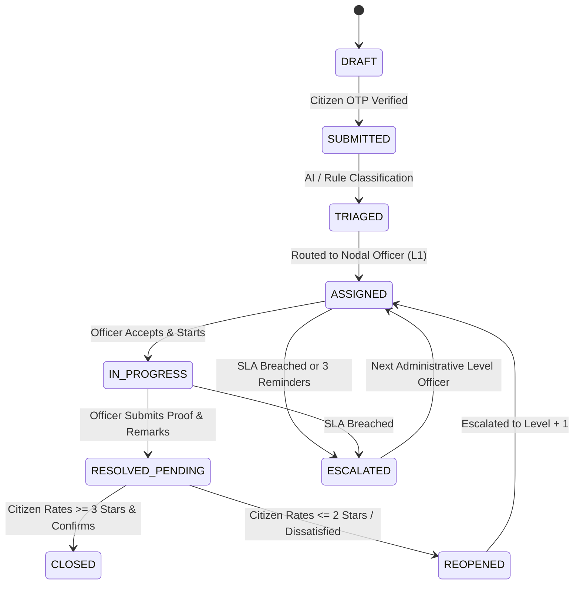

# Samadhan Setu (समाधान सेतु) — System Design Document
**PRAYAS 2026 Hackathon** | Government of Uttarakhand (ITDA & SeMT)

---

## 1. System Overview & Problem Formulation
The **Samadhan Setu** civic platform unifies public grievance redressal (**CM Helpline 1905**) with public service delivery tracking (**Apuni Sarkar / e-District**). It solves:
1. **Unusable forms & drop-down confusion**: Replaced by **Voice-first Hindi speech input** and **AI auto-classification**.
2. **Missing Post-Submission Visibility**: Solved via **real-time visual timeline**, dynamic **SLA countdown**, and automated SMS updates.
3. **Premature Force-Closing**: Solved through the **Citizen Feedback Barrier** — complaints cannot be closed without citizen confirmation (rating ≤ 2 auto-reopens and escalates).
4. **Delayed e-District Services**: Solved by the **Apuni Sarkar Bridge**, auto-detecting SLA breaches on certificates and escalating them as priority CM Helpline tickets.
5. **Zero Statistics Bug**: Solved by the **Public Transparency Dashboard**, aggregating live resolutions, district heatmaps, and department response times.

---

## 2. Domain Model & Lifecycle State Machine

---

## 3. SLA & 4-Level Administrative Escalation Model

| Administrative Tier | Designation in Uttarakhand | Escalation Trigger |
|---|---|---|
| **Level 1 (L1)** | Junior Engineer (JE) / Patwari / Gram Vikas Adhikari | Initial auto-assignment on submission |
| **Level 2 (L2)** | Assistant Engineer (AE) / Tehsildar / BDO | L1 SLA breach OR 3 citizen reminders |
| **Level 3 (L3)** | Executive Engineer (EE) / Sub-Divisional Magistrate (SDM) | L2 SLA breach OR Citizen Re-open |
| **Level 4 (L4)** | District Magistrate (DM) / Secretary / CMO Oversight Cell | L3 SLA breach / Critical emergency |

### SLA Math:
$$\text{ResponseTarget} = \text{BaseHours} \times \text{UrgencyModifier}$$
$$\text{ResolutionTarget} = \frac{\text{BaseResolutionHours} \times \text{UrgencyModifier}}{\text{EscalationLevel}}$$
- Emergency urgency cuts resolution target to **24 hours**.
- Citizen reminders are subject to a **48-hour cooldown period**.
